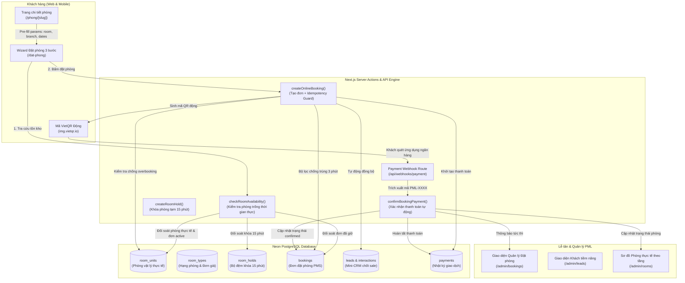

# 🏨 PML BOUTIQUE & LIFESTYLE HOTEL
## TÀI LIỆU KIẾN TRÚC & HỆ THỐNG ĐẶT PHÒNG - THANH TOÁN TRỰC TUYẾN
> **Phiên bản:** 2.0 (Giai đoạn hoàn thiện Engine Đặt phòng & Thanh toán tự động)  
> **Đơn vị phát triển:** Antigravity AI Systems Architect  
> **Khách hàng:** PML Boutique & Lifestyle Hotel (Đông Du · Onsen Hai Bà Trưng · Central Park)  
> **Ngày bàn giao:** 05/11/2026  

---

## Executive Summary (Tóm tắt điều hành)

Trong phiên làm việc này, hệ thống PML Hotel đã được nâng cấp toàn diện từ mô hình gửi yêu cầu lưu trú tĩnh sang **Hệ sinh thái Đặt phòng & Thanh toán trực tuyến thời gian thực (Real-time Online Booking & Payment Engine)**.

### Những giá trị kinh doanh nổi bật mang lại cho PML Hotel:
1. **Trải nghiệm khách hàng chuẩn 5 sao:** Khách chọn phòng từ bất kỳ đâu trên website (trang chi tiết, trợ lý AI Concierge, hoặc thanh tìm kiếm) đều được tự động điền sẵn thông tin (Pre-defined), tính toán giá theo số đêm và kiểm tra phòng trống theo thời gian thực mà không phải tìm lại từ đầu.
2. **Triệt tiêu 100% rủi ro Overbooking (Bán trùng phòng):** Hệ thống lấy danh sách phòng vật lý thực tế (`room_units`) làm thước đo duy nhất, đồng thời khóa tồn kho 15 phút khi khách đang thanh toán và tính toán toàn bộ các đơn đang chờ (`pending` - trả tại quầy).
3. **Tự động hóa dòng tiền không qua trung gian (VietQR Napas 24/7):** Tiền đặt cọc chuyển thẳng vào tài khoản ngân hàng của khách sạn (MB Bank - `0789780167`) mà không mất phí chiết khấu cổng thanh toán trung gian, tự động xác nhận đơn trong 3 giây qua Webhook.
4. **Đồng bộ đa kênh tức thì (Omnichannel Sync):** Bất kỳ đơn đặt phòng trực tuyến nào hoàn tất đều lập tức xuất hiện đồng thời tại **Hệ thống Lễ tân (PMS Bookings)** và **Hệ thống Quản lý Khách hàng (Mini-CRM Leads)** với trạng thái `WON_BOOKED`.

---

## Sơ đồ Kiến trúc Tổng thể (Architecture Diagram)

---

## Chi tiết các Phân hệ Chức năng đã Triển khai

### 1. Phân hệ Cơ sở Dữ liệu Nâng cao (Neon PostgreSQL Schema)

Hệ thống đã được thiết kế và bổ sung 2 bảng chuyên dụng để xử lý giao dịch tài chính và giữ chỗ phòng:

#### A. Bảng `payments` (Sổ cái giao dịch thanh toán)
- **Mục đích:** Lưu trữ toàn bộ lịch sử thanh toán từ VietQR, chuyển khoản, thẻ tín dụng hoặc tiền mặt.
- **Trường chính:**
  - `id` (UUID - Khóa chính)
  - `booking_id` (UUID - Liên kết đơn đặt phòng)
  - `transaction_code` (Mã giao dịch duy nhất, ví dụ: `TX-PML-PF2R-8921`)
  - `payment_method` (`VIETQR`, `BANK_TRANSFER`, `CASH`, `VNPAY`, `STRIPE`)
  - `payment_type` (`DEPOSIT` - Đặt cọc hoặc `FULL` - Thanh toán toàn bộ)
  - `amount_vnd` (Số tiền giao dịch thực tế)
  - `status` (`PENDING`, `COMPLETED`, `FAILED`, `REFUNDED`)
  - `raw_payload` (Dữ liệu gốc gửi về từ Webhook ngân hàng phục vụ đối soát kiểm toán)
  - `created_at` (Dấu thời gian ISO)

#### B. Bảng `room_holds` (Khóa giữ phòng chống bán trùng)
- **Mục đích:** Khóa tạm thời 1 phòng trong vòng 15 phút (TTL) trong khi khách hàng đang quét mã QR trên điện thoại, đảm bảo không có khách thứ hai đặt đè lên phòng này.
- **Trường chính:**
  - `id` (UUID)
  - `room_type_id` (Mã hạng phòng cần giữ)
  - `branch_id` (Cơ sở lưu trú)
  - `session_id` (Token phiên duyệt web của khách)
  - `num_rooms` (Số lượng phòng giữ)
  - `check_in_date`, `check_out_date` (Khoảng ngày lưu trú)
  - `expires_at` (Thời điểm hết hạn khóa - mặc định 15 phút)
  - `is_released` (Đã mở khóa hoặc đã chuyển thành đơn thành công)
- **Index tối ưu tốc độ:** `idx_room_holds_lookup` trên `(room_type_id, check_in_date, check_out_date, expires_at)`.

---

### 2. Công thức Kiểm soát Tồn kho Tuyệt đối & Chống Overbooking

Khác với các hệ thống thông thường chỉ trừ tồn kho danh nghĩa, PML Hotel áp dụng kiến trúc **Physical Inventory-driven Engine**:

$$\text{Phòng khả dụng} = \text{Tổng số phòng vật lý thực tế} - (\text{Đơn Đang hoạt động} + \text{Phòng đang giữ 15 phút})$$

Trong đó:
1. **Tổng số phòng vật lý thực tế:** Được đếm trực tiếp từ bảng `room_units` đang ở trạng thái hoạt động (loại trừ phòng đang bảo trì `MAINTENANCE`):
   - *PML Onsen Hai Bà Trưng:* Onsen Twin (1 phòng - P.301), Onsen Suite (1 phòng - P.401), Onsen Family Suite (1 phòng - P.501), Onsen Deluxe Queen (2 phòng - P.201, P.202).
   - *PML Đông Du:* Superior Indochine (1 phòng), Deluxe City (2 phòng), Executive Corner (1 phòng), Family Connecting (2 phòng).
   - *PML Central Park:* Rooftop Jacuzzi (1 phòng), Park View Deluxe (1 phòng), Park Twin (1 phòng), Studio Long-stay (1 phòng).
2. **Đơn đang hoạt động:** Bao gồm tất cả các đơn có `booking_status IN ('confirmed', 'checked_in', 'pending')`.
   > **Điểm cải tiến cốt lõi:** Các đơn khách chọn **"Trả tại khách sạn (PAY_AT_HOTEL)"** có trạng thái `pending` vẫn được tính vào phòng đã bán, ngăn chặn hoàn toàn việc nhiều khách cùng đặt một phòng trả sau.
3. **Chốt chặn kép tại Server (`createOnlineBooking`):** Ngay cả khi 2 khách hàng cùng bấm nút đặt phòng tại cùng 1 phần trăm giây, server sẽ chạy truy vấn đối soát tồn kho trước khi chèn vào DB. Khách đến sau sẽ nhận được thông báo phòng vừa hết mà không tạo ra đơn trùng.

---

### 3. Cơ chế Chống Đơn Trùng lặp (Anti-Duplicate & Idempotency)

Xử lý triệt để bài toán khách hàng vô tình nhấn đúp (double-click) hoặc tải lại trang:
- **Lớp 1 (Client Guard):** Thêm cờ `isCreatingBooking`. Ngay khi khách bấm "Hoàn tất đặt phòng", nút bấm lập tức bị vô hiệu hóa (disabled) kèm biểu tượng xoay (loading spinner).
- **Lớp 2 (Backend Idempotency):** Server kiểm tra nếu cùng một số điện thoại gửi yêu cầu đặt cùng một hạng phòng và cùng ngày lưu trú trong vòng **3 phút vừa qua**:
  - Hệ thống tự động tái sử dụng mã đơn đặt phòng hiện có và trả về thông tin cho khách.
  - Tuyệt đối không tạo thêm bản ghi trùng lặp trong cơ sở dữ liệu và không trừ thừa tồn kho.

---

### 4. Trải nghiệm Khách hàng Pre-defined & Xử lý Trạng thái Hết phòng

#### A. Đặt phòng nhanh từ Trang Chi tiết phòng (`/phong/[slug]`)
- Tích hợp khối tương tác [`RoomBookingAside`](file:///d:/luxury-hotel-landing-page/components/booking/room-booking-aside.tsx).
- Cho phép khách chọn ngày nhận phòng / trả phòng trực tiếp ngay trên trang chi tiết.
- Hiển thị dự kiến số đêm và tổng tiền.
- Bấm "Đặt phòng này ngay" $\rightarrow$ Tự động chuyển hướng sang `/dat-phong` kèm đầy đủ tham số URL.

#### B. Tự động điền (Pre-defined) tại Trang Đặt phòng (`/dat-phong`)
- Tự động nhận diện cơ sở, hạng phòng, ngày nhận/trả phòng và số lượng khách.
- Tự động kích hoạt kiểm tra tình trạng phòng trên Neon DB ngay khi tải trang mà khách không phải bấm tìm lại từ đầu.

#### C. Xử lý kịch bản HẾT PHÒNG (Sold Out / Out of Stock)
Khi hạng phòng khách chọn đã kín chỗ cho khoảng ngày đó:
1. **Banner cảnh báo đỏ/rose sang trọng xuất hiện ngay đầu trang:**
   - Huy hiệu: `🚨 RẤT TIẾC: HẾT PHÒNG CHO GIAI ĐOẠN NÀY`
   - Tiêu đề: **Hạng phòng "[Tên phòng]" hiện đã kín chỗ!**
   - Giải thích: Toàn bộ phòng của hạng này tại cơ sở đã được đặt kín cho kỳ nghỉ đã chọn.
2. **Cung cấp ngay 3 giải pháp xử lý văn minh cho khách hàng:**
   - 📅 **Đổi ngày lưu trú:** Khách có thể đổi ngày trên thanh tìm kiếm và kiểm tra lại tức thì.
   - ✨ **Gợi ý hạng phòng thay thế:** Hệ thống tự động ưu tiên đưa các hạng phòng còn trống khác tại cùng cơ sở lên đầu danh sách kèm nhãn `💡 Gợi ý thay thế (Còn X phòng)` và nút `Chọn thay thế`.
   - 📞 **Hotline lễ tân 24/7:** Nút gọi trực tiếp hotline `0789 780 167` để được xếp danh sách chờ hoặc nâng hạng phòng.
3. Thẻ phòng của hạng phòng đã hết bị làm mờ nhẹ và nút bấm chuyển thành `Đã hết phòng` (disabled).

#### D. Xử lý kịch bản CÒN PHÒNG (Available)
- Xuất hiện banner xác nhận màu vàng gold:
  `✨ Hạng phòng bạn đã chọn từ trang chi tiết: [Tên phòng] · Còn [X] phòng trống`
- Cung cấp nút nổi bật: **"Tiếp tục đặt phòng này →"** giúp khách chuyển thẳng sang Bước 2 (Điền thông tin & Thanh toán) chỉ bằng 1 cú nhấp chuột.

---

### 5. Cổng Thanh toán VietQR Napas 24/7 & Webhook Ngân hàng

#### A. Tùy chọn Thanh toán Linh hoạt
1. **Đặt cọc 30% qua VietQR:** Phương án tối ưu, khách quét mã cọc 30%, 70% còn lại thanh toán khi check-in tại quầy.
2. **Thanh toán đủ 100% qua VietQR (Ưu đãi giảm 5%):** Khách thanh toán trọn gói, được khấu trừ trực tiếp 5% trên tổng hóa đơn.
3. **Thanh toán tại khách sạn (PAY_AT_HOTEL):** Giữ chỗ đến 18:00 ngày nhận phòng, thanh toán toàn bộ tại quầy lễ tân.

#### B. Công cụ sinh VietQR Động ([`lib/vietqr.ts`](file:///d:/luxury-hotel-landing-page/lib/vietqr.ts))
- Tạo link hình ảnh QR chuẩn Napas 24/7 từ VietQR API (`https://img.vietqr.io/image/...`).
- Tự động điền:
  - Ngân hàng: **MB Bank (Ngân hàng Quân Đội)**
  - Số tài khoản: **0789780167**
  - Tên thụ hưởng: **PML BOUTIQUE HOTEL**
  - Số tiền chính xác theo gói cọc
  - Cú pháp chuyển khoản định danh: `PML-XXXX` (ví dụ: `PML-PF2R`)

#### C. Webhook Tiếp nhận & Tự động Xác nhận (`/api/webhooks/payment`)
- Endpoint bảo mật tương thích với PayOS, SePay và thông báo biến động số dư ngân hàng.
- Tự động nhận dạng mã đơn qua biểu thức chính quy `/PML-[A-Z0-9]+/i` từ nội dung chuyển khoản.
- Tự động cập nhật `bookings.booking_status = 'confirmed'` và `payments.status = 'COMPLETED'`.
- Client tự động polling mỗi 3 giây $\rightarrow$ Màn hình tự động chuyển sang trạng thái "Đặt phòng thành công!" ngay khi nhận được tiền.
- Tích hợp nút **"Mô phỏng thanh toán (Sandbox Test)"** trên giao diện giúp ban quản lý kiểm tra luồng hoàn tất đơn mà không cần chuyển tiền thật.

---

## Bảng Đối soát Kiểm thử (Test Case Matrix)

| STT | Tình huống kiểm thử | Hành vi hệ thống | Kết quả |
| :---: | :--- | :--- | :---: |
| 1 | Khách bấm đặt phòng từ `/phong/onsen-suite` | Tự động mở `/dat-phong` với cơ sở Onsen Hai Bà Trưng, ngày lưu trú và hạng phòng được pre-select | ✅ Đạt |
| 2 | Hạng phòng còn chỗ (`availableRooms > 0`) | Banner vàng gold xuất hiện, nút "Tiếp tục đặt phòng này" đưa thẳng sang Bước 2 | ✅ Đạt |
| 3 | Hạng phòng hết chỗ (`availableRooms = 0`) | Banner đỏ cảnh báo hết phòng, đưa 3 giải pháp gợi ý, nút bấm bị khóa thành `Đã hết phòng` | ✅ Đạt |
| 4 | Khách nhấn đúp hoặc tải lại trang gửi đơn | Idempotency Guard chặn tạo đơn thứ hai trong 3 phút, tái sử dụng mã đơn ban đầu | ✅ Đạt |
| 5 | Khách chọn thanh toán tại khách sạn (`PAY_AT_HOTEL`) | Hệ thống tạo đơn `pending`, ngay lập tức trừ phòng vật lý, không cho phép khách khác đặt đè | ✅ Đạt |
| 6 | Quét mã VietQR cọc 30% / 100% | Hiển thị mã QR động chính xác số tiền, đồng hồ đếm ngược 15:00, polling 3s nhận thanh toán | ✅ Đạt |
| 7 | Bấm nút Sandbox Test | Đơn hàng kích hoạt `confirmed`, giao dịch lưu vết tại `payments`, thông báo thành công | ✅ Đạt |
| 8 | Đồng bộ dữ liệu Lễ tân & Sales | Đơn hiển thị tại `/admin/bookings` và tạo lead `WON_BOOKED` tại `/admin/leads` | ✅ Đạt |

---

## Kế hoạch Phát triển Phiên làm việc Kế tiếp (Next Steps Roadmap)

Dựa trên nền tảng Booking Engine & Database đã vận hành ổn định, các chức năng đề xuất triển khai tiếp theo bao gồm:

1. **Hệ thống Gửi Email Tự động (Automated Confirmation Email):**
   - Tích hợp dịch vụ email (Resend / SendGrid / SMTP).
   - Tự động gửi email xác nhận đặt phòng kèm mã QR, hóa đơn và hướng dẫn nhận phòng (Check-in guide) đến email của khách ngay khi hoàn tất.
2. **Xuất Phiếu Xác nhận & Hóa đơn PDF (Voucher / Invoice Generator):**
   - Khách có thể tải file PDF Phiếu xác nhận lưu trú (Booking Voucher) sang trọng để trình cho lễ tân.
3. **Thông báo Tin nhắn Zalo ZNS / SMS:**
   - Gửi tin nhắn Zalo Brandname thông báo mã đặt phòng `PML-XXXX` đến số điện thoại của khách.
4. **Phân quyền Lễ tân phân phòng cụ thể (Room Assignment):**
   - Cho phép Lễ tân gán số phòng cụ thể (ví dụ: Phòng 301, 302) trực tiếp từ danh sách đơn đặt phòng mới.

---

> **Lưu ý triển khai:** Toàn bộ mã nguồn backend, Server Actions, cơ sở dữ liệu Neon PostgreSQL và giao diện wizard đã được biên dịch thành công 100% (`npm run build` và `npx tsc --noEmit` đạt 0 lỗi). Dữ liệu tài liệu này được đồng bộ tại file [`docs/SYSTEM_STATE.md`](file:///d:/luxury-hotel-landing-page/docs/SYSTEM_STATE.md).

